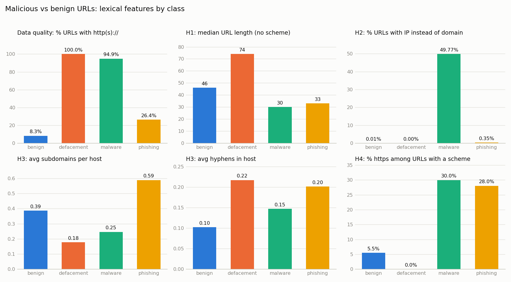

# Malicious URL lexical analysis

Воспроизводимый мини-пайплайн Data Engineering: сырой CSV с URL → проверка качества → очистка → признаки → SQLite → проверка гипотез SQL-запросами.

**Вопрос.** Отличаются ли вредоносные URL от безопасных по простым признакам самой строки, без захода на сайт?

Зачем: антивирусу или браузерному фильтру нужно решить, опасна ли ссылка, ещё до загрузки страницы. В этот момент самая дешёвая доступная информация — сама строка URL.



## Данные

- **Источник:** [Malicious URLs dataset](https://www.kaggle.com/datasets/sid321axn/malicious-urls-dataset) (Kaggle). Скачиваем [дедуплицированное зеркало на Hugging Face](https://huggingface.co/datasets/bgspaditya/malicious-600k) (MIT), оно не требует авторизации. Исходный набор собран из ISCX-URL-2016, PhishTank, PhishStorm, Malware Domain Blacklist и других источников.
- **Размер:** 640 993 строки, после очистки 640 884.
- **Классы:**

| класс | строк | доля |
|---|---:|---:|
| benign | 427 971 | 66.8% |
| defacement | 95 308 | 14.9% |
| phishing | 93 960 | 14.7% |
| malware | 23 645 | 3.7% |

## Пайплайн

```
extract  →  quality check  →  clean  →  features  →  SQLite  →  SQL-гипотезы
```

| шаг | файл | что делает |
|---|---|---|
| extract | [pipeline/extract.py](pipeline/extract.py) | скачивает train/val/test CSV, объединяет, переводит числовые метки в названия |
| quality | [pipeline/quality.py](pipeline/quality.py) | пропуски, дубликаты, противоречивые метки, баланс классов, доля префиксов `http(s)://`, по 10 случайных URL каждого класса → [reports/data_quality.md](reports/data_quality.md) |
| clean | [pipeline/clean.py](pipeline/clean.py) | trim, удаление пустых, битых, дублирующихся и противоречиво размеченных строк, нормализованный URL без схемы |
| features | [pipeline/features.py](pipeline/features.py) | 17 лексических признаков: длина, хост, IP, порт, `@`, точки, дефисы, поддомены, https и др. |
| load | [pipeline/load.py](pipeline/load.py), [sql/schema.sql](sql/schema.sql) | таблица `urls` в `data/urls.db` с CHECK-ограничением на метку и индексом |
| analyze | [pipeline/analyze.py](pipeline/analyze.py), [sql/hypotheses.sql](sql/hypotheses.sql) | один SQL-запрос на гипотезу → [reports/results.md](reports/results.md) и график |

Запуск (Python 3.10+):

```bash
pip install -r requirements.txt
python run_pipeline.py
```

Данные (~40 МБ CSV) скачиваются автоматически в `data/raw/`. Папка `data/` не хранится в git. Запросы можно выполнить и вручную: `sqlite3 data/urls.db < sql/hypotheses.sql`.

## Проблемы данных

**1. Признак «есть https» отражает источник данных, а не опасность.** Это главная находка проекта. Перед подсчётом признаков я посмотрел по 10 случайных URL каждого класса и долю строк со схемой:

| класс | начинается с `http(s)://` | начинается с `https://` |
|---|---:|---:|
| benign | 8.3% | 0.5% |
| defacement | **100%** | 0.0% |
| malware | 94.9% | 28.4% |
| phishing | 26.4% | 7.4% |

Безопасные URL почти всегда записаны без схемы (`en.wikipedia.org/wiki/...`), а defacement — всегда с ней (`http://www.site.com/...`). Это следствие того, что классы собраны из разных источников. Поэтому:

- наивная доля https по всем строкам (benign 0.45%) сравнивает в основном не безопасность, а формат записи;
- наивная длина URL завышена у defacement/malware примерно на 7 символов только за счёт `http://`;
- классификатор на таких данных выучит правило «есть `http://` → вредоносный», которое в реальном браузере бесполезно: там схема есть у каждого URL.

**Как учтено:** все счётчики и длина считаются по нормализованному URL без схемы (`url_length`, сырая длина сохранена как `url_length_raw` для сравнения). Долю https сравниваю только среди URL, у которых схема вообще есть (`pct_https_among_scheme`). Для H1 дополнительно сравниваю классы внутри групп «со схемой» и «без схемы».

**2. Противоречивые метки.** 6 URL встречались дважды с разными классами. Все 12 строк удалены: неизвестно, какой метке верить.

**3. Битые строки.** В выборке phishing попалась бинарная строка вместо URL. Проверка нашла 87 строк с управляющими символами (85 из них в phishing) и ещё 10 фрагментов без домена (`bin/webscr?cmd=_login-`). Все 97 удалены. При этом адреса вида `0xdaf1be2b/...` и `772050312/...` *не* мусор: это IPv4 в шестнадцатеричной и десятичной записи, известный приём маскировки. Они оставлены и засчитываются в `has_ip`.

**4. Шум в классе phishing.** Среди случайных «фишинговых» URL попадаются явно легитимные адреса, например `tools.ietf.org/html/rfc1861`, `www.nps.gov/...` и университетские страницы. Вероятно, это наследие исходного набора ISCX/PhishStorm. Строки оставлены как есть, но это ограничивает выводы по phishing.

## Результаты

| | гипотеза | итог | ключевые цифры |
|---|---|---|---|
| H1 | фишинговые URL длиннее | **не подтвердилась (обратное)** | медиана длины: phishing 33, benign 46; среднее 43.6 vs 56.9 |
| H2 | IP вместо домена чаще во вредоносных | **подтвердилась (для malware)** | malware 49.8%, phishing 0.35%, benign 0.007% |
| H3 | у фишинга больше подозрительных элементов | **частично** | `@`: 0.70% vs 0.14%; поддомены: 0.59 vs 0.39; дефисы в хосте: 0.20 vs 0.10; дефисы во всём URL: 0.47 vs 1.84 (ниже) |
| H4 | https не гарантирует безопасность | **подтвердилась** | 28% фишинговых URL со схемой используют https; из всех https-URL в наборе 88% вредоносные |

**H1. Не подтвердилась.** В этом датасете фишинговые URL *короче* безопасных. Это не артефакт схемы: внутри групп с одинаковым форматом записи картина та же. Без схемы: phishing 32.3 vs benign 52.4. Со схемой: 75.1 vs 107.5. Самые длинные URL у defacement: медиана 74, это длинные CMS-адреса вида `index.php?option=com_...`. Популярное правило «длинный URL = подозрительный» здесь не работает.

**H2. Подтвердилась, но неравномерно.** Половина malware-URL — это голые IP (`http://37.49.226.159/bins/...`, раздача ботнет-бинарников). У phishing IP встречается в 50 раз чаще, чем у benign, но в абсолютных цифрах редко (0.35%). Признак сильный для malware и почти бесполезный для фишинга.

**H3. Частично подтвердилась.** У phishing выше доля `@` (в 5 раз), больше поддоменов и дефисов *в хосте* (`paypal-secure-login.example.com`). Но дефисов во всём URL у benign больше: это «слаги» в путях статей (`/how-to-cook-pasta`). Вывод: значение признака зависит от того, *где* в URL он стоит. Счётчик по всей строке смешивает два противоположных сигнала.

**H4. Подтвердилась.** Среди URL, у которых схема указана, https есть у 28% фишинговых и 30% malware-URL, против 5.5% у benign. Замок в адресной строке говорит только о шифровании канала, но не о честности сайта. Цифру «88% https-URL вредоносны» нельзя переносить на реальный трафик: она во многом следствие того, что у безопасных URL в этом наборе почти нет схемы (проблема 1).

## Чего не утверждаем

Это **описательный анализ, а не доказательство причин**. Формулировка «фишинговые URL короче *в этом датасете*», а не «короткий URL опасен». Классы собраны из разных источников и разных лет, поэтому часть различий может отражать способ сбора, а не природу угрозы. Проблема 1 это наглядно показывает.

## Ограничения и что дальше

- Классы не сбалансированы по источникам. Нужна проверка на независимом наборе, например свежие PhishTank/URLhaus против Tranco top-1M с одинаковой нормализацией.
- Признаки только лексические. Возраст домена, WHOIS, TLS-сертификат и репутация хоста не используются.
- Следующий шаг: обучить простой классификатор (логистическая регрессия или gradient boosting) на признаках из таблицы `urls`, с `has_scheme` и `is_https` и без них. Разница в качестве покажет, сколько модель «выигрывает» на артефакте.
- Разделить признаки по частям URL (хост / путь / query), раз H3 показала, что это важно.

## Структура

```
├── run_pipeline.py        # точка входа
├── pipeline/              # шаги пайплайна
├── sql/schema.sql         # схема таблицы
├── sql/hypotheses.sql     # по одному запросу на гипотезу
└── reports/               # отчёт о качестве, результаты запросов, график
```
